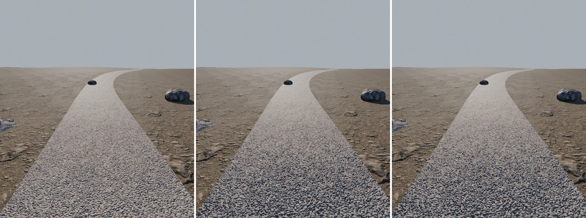
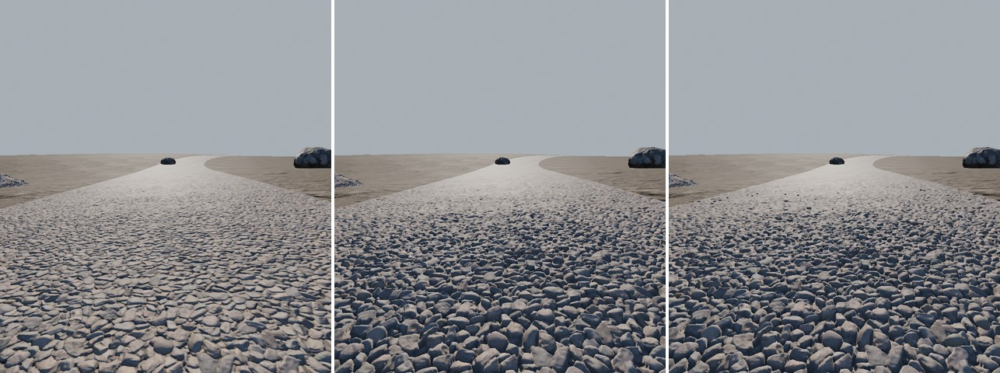
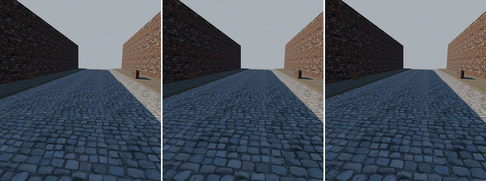
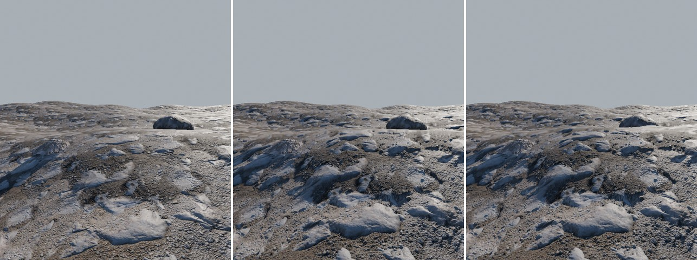
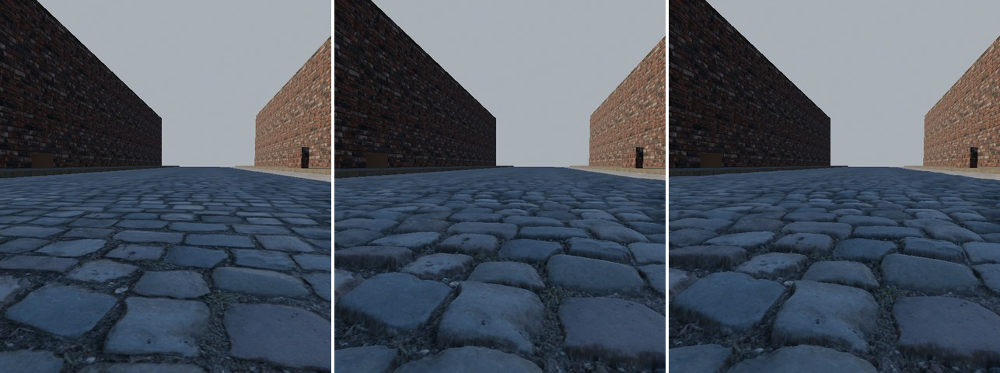
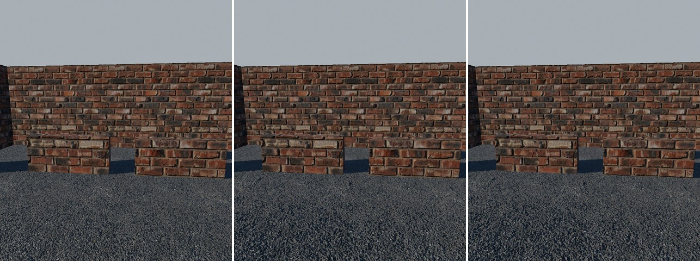
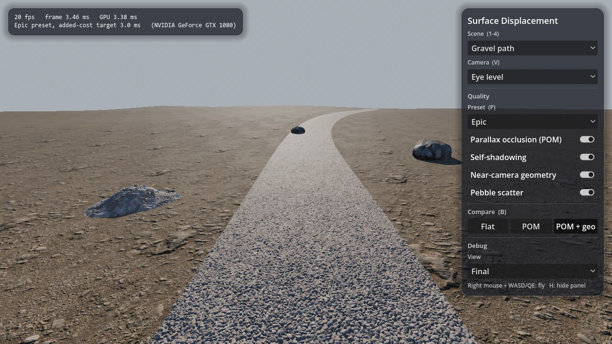
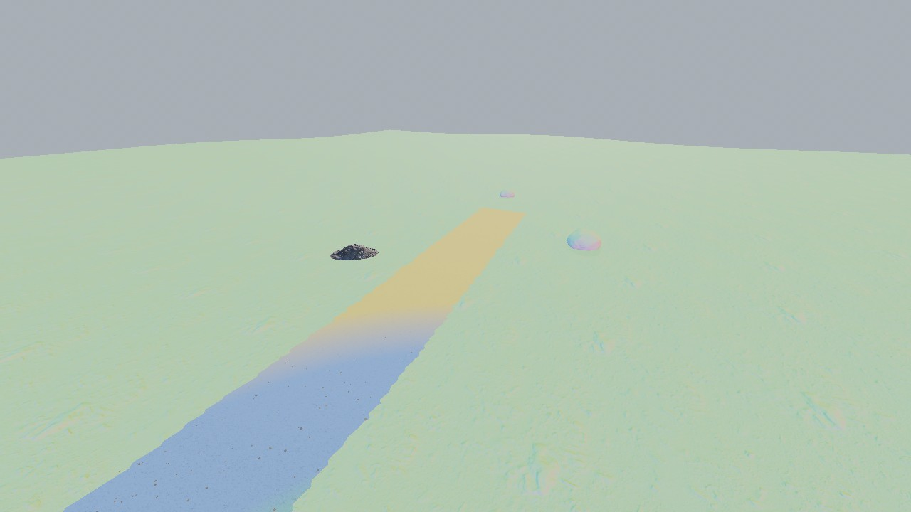
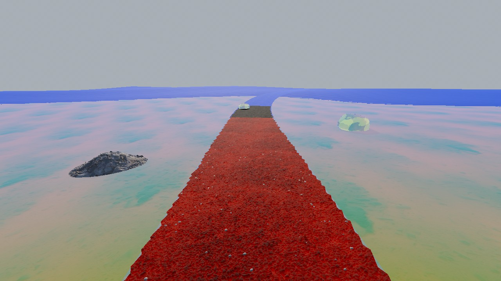

# Surface Displacement for Godot 4.7

UE5-style surface displacement for Godot's Forward+ renderer: gravel that reads as individually
scattered stones, cobblestones as real stones, brick walls with deep joints - from ordinary PBR
texture sets with a height map.




*Gravel path (Poly Haven clean_pebbles), at eye level and at a grazing angle. Left to right: flat
(normal mapping only, preset Off), POM (Epic parallax and self-shadowing), POM + geometry (Epic
with the near-camera geometry and pebble scatter). Captured by `tools/capture_screenshots.gd`.*

| | |
|---|---|
|  |  |
| Cobblestone street, eye level (flat / POM / POM + geometry) | Rocky ground, eye level |
|  |  |
| Cobblestone street, grazing | Brick wall and props, eye level |

Full-size single images of every scene, view and mode are in [docs/images](docs/images)
(`<scene>_<view>_<flat|pom|pom_geometry>.jpg`), all from `tools/capture_screenshots.gd`.

Godot 4.7 has no tessellation and no Nanite, so the addon combines three layers that each do
what the engine allows:

1. **Parallax occlusion mapping (POM), done properly**, on any mesh: adaptive step count,
   binary refinement, mip-correct sampling, a fade into plain normal mapping, relief depth in
   metres, lighting and received shadows at the relief (`LIGHT_VERTEX`), optional
   contact-hardening self-shadowing with a `light()` that reproduces Godot's own shading, and
   opt-in depth write so props sink into the relief. UV, world-planar and triplanar mapping.
2. **Real displaced geometry near the camera** for ground (`DisplacementField3D`): a
   camera-centred grid of LOD rings reaching 12.8-15.4 m from the camera, crack-free, displaced by the same height
   maps, draped over any ground mesh via a top-down bake. Stones get silhouettes and real
   depth; the ground's collision is unchanged. It blends seamlessly into POM beyond the grid.
3. **Pebble scatter** (`PebbleScatter3D`): loose pebbles as real little meshes in camera-following
   GPU particle cells.

Plus `tools/bake_displaced_mesh.py`, an offline Blender tool that bakes the relief of the few
props whose silhouette POM cannot give into real triangles.

## Features

- Ready-made shaders for UV, world-planar and triplanar mapping, each flat / POM /
  POM + self-shadow, the POM ones optionally with depth write (15 surface shaders plus 3 for the
  field, generated from one `.gdshaderinc` library you can include in your own shaders).
- POM measured against a CPU ray / height-field intersection: 0.13 mm 90th-percentile hit error
  on a 50 mm relief, from steep to grazing views, for all mappings (`tests/render_tests.gd`).
- Self-shadowing whose `light()` matches Godot's built-in lighting to 0.09 % (99th percentile).
- Triplanar that marches only the planes with weight (1 plane on a floor, 2 on a 45-degree roof).
- Near-camera geometry with geomorphing between rings: zero cracks, no swimming, heights exact
  to 0.03 mm against the height map.
- Presets Low / Medium / High / Epic with budgets for a GTX 1080 at 1080p, plus per-feature
  switches and a small script API for settings menus.
- Editor tools: add nodes, convert StandardMaterial3D / ORMMaterial3D with a height map (undoable),
  bake the ground under a field, turn 8-bit height maps into 16-bit EXR, validate the setup.
- A demo with four scenes (gravel path, cobblestone street, rocky ground, brick wall and
  props), a flat / POM / POM + geometry comparison and a frame-time overlay.

## Requirements

- **Godot 4.7** or newer (developed and tested on 4.7.2-stable).
- The **Forward+** renderer (Vulkan tested on Windows 10, NVIDIA GeForce GTX 1080). Mobile and
  Compatibility are untested; the near-camera geometry and scatter need a rendering device.
- Height maps with more than 8 bits (16-bit PNG or EXR). 8-bit height maps work but terrace
  visibly once displaced by more than a few centimetres.
- Optional: Python 3.10+ with numpy and Pillow for the texture tools, Blender 4.5 LTS for the
  offline hero bake.

## Installation

1. **Asset Store / Asset Library:** search for "Surface Displacement" and install it.
   **By hand:** copy `addons/surface_displacement` into your project's `addons/` folder. It is
   self-contained.
2. Enable **Surface Displacement** in Project > Project Settings > Plugins. It registers five
   global shader uniforms (`sd_pom_steps`, `sd_pom_range`, `sd_shadow`, `sd_debug`, `sd_dfg`) in
   Project Settings > Shader Globals. Keep them: every Surface Displacement shader reads them.
3. If materials failed to compile before the plugin was enabled, reload the project once.

## Quick start

1. Add a **SurfaceDisplacement** node to your scene (Project > Tools > Surface Displacement: Add
   SurfaceDisplacement Node). Pick a preset.
2. Give your surfaces Surface Displacement materials:
   - **Convert Materials** turns every StandardMaterial3D / ORMMaterial3D with a height map in
     the selection (or scene) into the matching UV or triplanar SD material (undoable). Then
     set each material's `height_m` to the real depth of its relief.
   - Or create one in the inspector: a ShaderMaterial with a shader from
     `addons/surface_displacement/shaders/variants/` (`sd_<uv|world|triplanar>_<flat|pom|pom_ss>[_depth].gdshader`).
   - Or in code:

     ```gdscript
     var gravel := SDMaterials.create(SDMaterials.Mapping.WORLD,
         {"albedo": load("res://gravel_albedo.jpg"), "normal": load("res://gravel_normal.jpg"),
          "orm": load("res://gravel_arm.jpg"), "height": load("res://gravel_height.exr")},
         {"height_m": 0.03, "texture_size_m": Vector2(2, 2)})
     ```
3. For ground you walk on: select the ground mesh and run **Add DisplacementField3D**. The field
   takes the ground's material as its layer, puts the ground into the `sd_ground` group, and
   bakes it at runtime (or run **Bake Ground** once in the editor to save `<scene>_ground.res`).
   Set the ground material's `height_center` to 0 (relief above the ground; see below).
   Add a **PebbleScatter3D** as the field's child for loose pebbles.
4. Run **Validate Setup** if something looks wrong; it lists missing globals, wrong texture
   imports, materials the field cannot use and more.

## Configuration

### Materials

| Parameter | Default | Meaning |
|---|---|---|
| `albedo_texture`, `albedo_tint` | white | Base colour. |
| `normal_texture`, `normal_strength` | flat, 1 | OpenGL-convention normal map (+Y up, as Godot). |
| `orm_texture` | white | R = ambient occlusion, G = roughness, B = metallic (Poly Haven "arm"). |
| `ao_strength`, `roughness_scale`, `metallic_scale`, `specular` | 1, 1, 0, 0.5 | As in ORMMaterial3D. |
| `height_texture` | white | Height in the red channel, 1 = top. **Import with mipmaps** (the march samples the right mip level; without mipmaps it aliases and costs more). Lossless or half-float. |
| `height_m` | 0.03 | Relief depth in **metres** from the lowest to the highest point. |
| `height_center` | 1 | Height that stays on the surface (UE's Displacement Center): 1 = relief carved into the surface (walls, props), 0 = relief standing on it (ground under a DisplacementField3D). |
| `height_remap` | (0, 1) | Height values mapped to 0 and 1. |
| `pom_steps_scale` | 1 | Per-material multiplier on the preset's step counts. |
| `self_shadow_strength` | 1 | 0 = no self-shadow on this material. |
| `uv_scale`, `uv_offset` | 1, 0 | UV mapping. |
| `texture_size_m`, `planar_offset_m` | 2 m, 0 | World and triplanar mapping: the size of one texture repeat and the texture's origin, in metres. |
| `planar_rotation_deg` | 0 | World mapping: the texture's turn about the vertical axis. |
| `triplanar_sharpness` | 4 | Blend sharpness; planes under 5 % weight are dropped. |

Your own shaders can use the library the same way the variants do: `render_mode
diffuse_burley, specular_schlick_ggx;` (the `light()` reproduces these modes), `#define
SD_MAPPING_UV` (or `SD_MAPPING_WORLD`, `SD_MAPPING_TRIPLANAR`), optionally `SD_POM`,
`SD_SELF_SHADOW`, `SD_DEPTH_WRITE`, then `#include
"res://addons/surface_displacement/shaders/sd_surface.gdshaderinc"`.

Depth write is a separate shader variant (`..._depth.gdshader`, or
`SDMaterials.set_depth_write(material, true)`): props then intersect the relief instead of the
flat surface. It costs early-Z for the material and runs the POM march in the depth pre-pass
too; use it on the few surfaces where objects stand close to deep relief (a wall with a crate
against it). See [Limitations](#limitations).

### The SurfaceDisplacement node

| Property | Default | Meaning |
|---|---|---|
| `enabled` | on | Off = the Off preset. |
| `preset` | Medium | Off / Low / Medium / High / Epic / Custom (`custom_settings`, an `SDSettings`). |
| `pom`, `self_shadow`, `near_field`, `scatter` | on | Feature switches. They can only take a feature away from the preset, never add one. |
| `debug_view` | Off | Hit offset, march cost, relief height, normals, self-shadow, field rings. |

One node per project scene; it writes the shader globals, switches every registered material
between its flat / POM / POM + self-shadow variant at runtime, and configures the fields and
scatters. Materials in the scene are registered automatically (also those added later);
`register_material()` / `register_scene()` cover materials created in code but not yet in the
tree. In the editor the node only writes the globals, so saved materials keep their variant.

Script API for a settings menu:

```gdscript
var sd := SurfaceDisplacement.find_in(get_tree())
sd.preset = SDSettings.Preset.HIGH
sd.set_feature(SurfaceDisplacement.Feature.SCATTER, false)
sd.is_feature_active(SurfaceDisplacement.Feature.NEAR_FIELD)   # preset AND switch
sd.get_budget_ms()                                             # target cost of the preset
sd.settings_changed.connect(_refresh_menu)
```

### Presets and measured cost

| Preset | POM steps (min-max, bisection) | Relief fades out | Self-shadow | Near-camera geometry | Pebbles |
|---|---|---|---|---|---|
| Off | - (normal mapping) | - | - | - | - |
| Low | 6-16, secant only | 12-20 m | - | - | - |
| Medium | 8-24, 3 | 20-35 m | hard, 8 steps, to 20 m | - | - |
| High | 8-24, 3 | 20-35 m | soft, 12 steps, to 20 m | 4 rings x 160 at 2 cm (12.8 m) | - |
| Epic | 12-32, 4 | 30-50 m | soft, 16 steps, to 30 m | 4 rings x 256 at 1.5 cm (15.4 m) | to 8 m |

(`core/sd_settings.gd`; Custom takes an `SDSettings` resource with every value.)

<!-- BENCHMARK -->

### DisplacementField3D

| Property | Default | Meaning |
|---|---|---|
| `layers` | - | Up to four SD ground materials (world-planar mapping, `height_center` 0). The field copies their textures and parameters (`sync_layers()` after changing them in code). |
| `ground_bake` | - | An `SDGroundBake`. Without one the field bakes at runtime (`bake_on_ready`), or displaces a flat plane at its own height. |
| `ground_group`, `bake_texel_size` | `sd_ground`, 5 cm | What is baked, and how finely. |
| `levels`, `resolution`, `base_spacing` | 4, 160, 2 cm | Rings, quads per ring side, finest vertex spacing. The preset sets them (High 4 x 160 at 2 cm: reaches 12.8 m from the camera; Epic 4 x 256 at 1.5 cm: 15.4 m). |
| `lift`, `fade_band` | 2 mm, 0.25 | Height above the ground mesh; outer fraction of the grid where the relief fades to flat. |
| `cast_shadows` | off | Shadows of the displaced geometry (the POM self-shadow already shadows the relief). |
| `camera` | active | The camera the grid follows. |

The field is drawn on top of the original ground and replaces its look where a layer is
displaceable. Collision stays on the original ground.

### PebbleScatter3D

A child of a DisplacementField3D. `density`, `radius` (8 m), `per_cell` (24), `cell_size` (1 m),
`size_range` (1.2-3.5 cm), `valley_bias` (preference for low points of the height map) and
`layer_density` (per field layer, default only layer 0).

### Debug views

`debug_view` on the node (or the demo's panel): **Hit offset** (how far the march moved each
pixel), **Cost** (red = linear + refinement steps / 64, green = triplanar planes / 3, blue = mip
level / 8), **Relief** (height at the hit), **Normals**, **Self-shadow** (the self-shadow factor
of the main light), **Field rings** (ring index and morph state).

## Height maps and textures

The relief is only as good as the height map. Poly Haven's CC0 sets come with float EXR
displacement maps; the repository has two tools for them (not shipped with the addon):

```
python tools/fetch_textures.py                    # the default sets, 2K, with EXR heights, md5-checked
python tools/fetch_textures.py rubble --res 4k    # any Poly Haven texture id
python tools/prepare_textures.py                  # -> demo/textures/<id>/ (the demo's copies)
python tools/prepare_textures.py --res 2048 gravel_stones rocks_ground_02
```

`prepare_textures.py` writes a single-channel half-float `<id>_height.exr` remapped to the 1st
/ 99th percentile, resized colour, normal and ARM maps, explicit `.import` settings (mipmaps
everywhere, lossless height, BC5 normal map), the Poly Haven license record and an `.sd.json`
with the real-world size and a suggested relief depth that `SDMaterials.from_texture_set()`
reads. The default sets: gravel_stones, rocky_gravel, clean_pebbles, cobblestone_floor_03 /
07 / 08 / 13, square_cobblestone, rocks_ground_02 / 04 / 05 / 06, rubble, brick_wall_001
(plus forest_ground_04 for the demo's terrain). The demo ships nine of them at 1-2K; get the
others (or higher resolutions) from <https://polyhaven.com/textures> with the tools above.

For your own 8-bit height maps: **Project > Tools > Surface Displacement: Prepare Height
Maps** (select the images in the FileSystem dock) writes `<name>_sd_height.exr`, remapped to the
full 0-1 range, with import settings. It cannot add precision that is not there, but it stops
further loss.

## Offline hero bake (Blender)

For props whose silhouette matters (a wall end, a rock seen against the sky),
`tools/bake_displaced_mesh.py` subdivides a mesh (or a primitive) in Blender, displaces its
vertices by the height map with the same conventions as the shaders, decimates and writes a
glTF:

```
blender -b --factory-startup -P tools/bake_displaced_mesh.py -- \
    --primitive box --size 2.0,0.9,0.3 --mapping box --texture-size-m 3.0 \
    --height brick_wall_001_disp_2k.exr --height-m 0.025 --midlevel 1.0 --even-offset \
    --edge-length 0.007 --max-tris 120000 --output demo/models/hero_brick_wall.glb
```

`-- --help` lists every option; `tests/test_blender_bake.py` checks the displaced vertices
against the height map. The demo's brick wall scene shows a baked hero wall next to a POM box.

## How it works

Details in [docs/ARCHITECTURE.md](docs/ARCHITECTURE.md). In short:

- **POM** marches from the top of the relief slab down along the view ray with
  `mix(max_steps, min_steps, N.V)` linear steps, bisects the bracketing interval and finishes
  with a secant step. The mip level is computed once from the rasterized UV derivatives and
  every march sample uses it (`textureLod`). The relief depth fades to zero between the fade
  distances, and the step count with it; beyond, no march runs at all.
- **Individual stones** come from four things together: 16-bit heights (8-bit terraces into
  flat plates), a refined intersection (stones keep their round tops and sharp contacts instead
  of the stair steps of a plain linear search), self-shadowing (each stone shadows its
  neighbours in the direction of the sun, contact-hardening like real shadows) and, near the
  camera, geometry: stones rise above the ground plane, stick out against what lies behind them
  at grazing views and get real depth for SSAO. Loose pebbles on top are real meshes.
- **The field** is a geometry clipmap of 4 rings, snapped to the camera so vertices never slide
  over the height map, with CDLOD-style geomorphing so each ring's outer edge matches the next
  ring exactly. Its fragments still march the full-resolution relief (a 2 cm grid cannot carry
  2 cm stones), so geometry and POM agree and the grid's edge is invisible.

## Project structure

```
addons/surface_displacement/      the addon (all that is shipped)
  core/                           SDSettings (presets), SDMaterials (variants), SDGlobals,
                                  SDGroundBake, SDHeightTools
  nodes/                          SurfaceDisplacement, DisplacementField3D, PebbleScatter3D
  shaders/                        the .gdshaderinc library, field / pebble / capture shaders
  shaders/variants/               the 15 surface and 3 field shaders (generated)
  textures/sd_dfg_lut.exr         Godot's DFG table, recomputed (for the energy compensation)
  tools/                          material converter, setup validator
  plugin.gd, plugin.cfg, README.md, LICENSE.md
demo/                             demo project: scenes, UI, fly camera, CC0 texture copies, models
docs/                             ARCHITECTURE.md, RESEARCH.md, images/
tests/                            test suites, harness, benchmark, mutation runner, log scanner
tools/                            engine runner, texture fetch / prepare, variant generator,
                                  DFG table, Blender bake, benchmark runner, screenshots
```

## Demo

Run the project (main scene `demo/demo_main.tscn`). Keys: **1-4** scene, **V** next camera
view (eye level, grazing, overview), **P** next preset, **B** next comparison (flat / POM /
POM + geometry), **H** hide the panel; hold the right mouse button and use **WASD/QE** to fly
(Shift fast, Alt slow).



| | |
|---|---|
|  |  |
| Field rings debug view (ring index and morph state) | March cost debug view (red: steps, green: triplanar planes, blue: mip level) |

Images: `tools/capture_screenshots.gd`.

## Tests

```
python tests/run_all.py              # everything below except benchmark and mutations
python tests/run_all.py --bench      # ... plus the benchmark (waits for an idle GPU)
python tests/run_all.py --mutations  # ... plus the mutation checks (slow)
python tests/run_mutations.py sign seam              # mutations whose name contains a word
python tools/godot.py --script tests/render_tests.gd -- --only=pom_matches,swim   # a subset
```

Engine runs go through `tools/godot.py`, which serialises them with a lock and finds Godot
via the `GODOT_BIN` environment variable, else `tools/.godot_path` (one line, git-ignored),
else `godot` on `PATH` (on Windows use the `*_console.exe` build). Render suites run
**headed**: `--headless` is a dummy renderer that draws nothing.

| Suite | What it checks |
|---|---|
| shader variants | The 18 variant files in the repository are what `tools/generate_variants.py` generates. |
| logic tests (headless, 40 checks) | Variants parse back to their mapping / quality / depth write; preset table, budgets and feature switches (a switch never adds a feature); the ring mesh (vertex count, no triangles in the holes, every ring's outer edge collapsing exactly onto the next ring's inner edge, seam flags); morph bands inside their rings for the High and Epic grids; the ground bake's CPU twin (`SDGroundBake.sample()`): bilinear heights at 16-bit precision, the gradient normal, nothing displaceable at or beyond the bake's border, a 30-degree slope is ground and a 45-degree slope and a 15 cm kerb are not at 5 cm and at 20 cm texels, a cell without ground, per-cell layers; every demo texture imported with mipmaps, heights as one-channel half float. |
| render tests (headed, 69 checks) | **POM against a CPU ray / height-field intersection** (world floor with relief above and below, UV floor, UV wall, triplanar floor and two walls; steep, 45-degree and grazing views): median hit error under 0.2 mm and 90th percentile under 0.4 mm on a 50 mm relief (measured worst 90th percentile 0.13 mm; without the bisection 1.0 mm). **Inverted `height_remap`** (1, 0) on an inverted map draws the same relief (99th percentile 0.10 mm). **World-planar walls**: finite, lit pixels (a smoke test, see the file). **No swimming**: 190 relief markers over 24 camera positions stay within 0.19 mm of their traced position. **Triplanar** marches 1 plane on a floor and 2 on a 45-degree roof. **light() vs Godot's built-in lighting** (dielectric, metal, metal at a grazing view): 99th percentile at most 0.07 %, maximum 0.17 % (limits 0.12 % / 0.3 %); the flat variant equals ORMMaterial3D exactly. **LIGHT_VERTEX**: on the 2 041 pixels whose received shadow depends on where it is computed, 100 % are lit or shadowed as on the relief. **Self-shadow** against a CPU height-field shadow: 99.8 % of 4 929 pixels agree (limit 98 %). **Depth write**: with it, props are cut where the relief (not the plane) predicts on 100 % of the 1 397 pixels where the two disagree, and 4 of 318 484 wall pixels are empty; without it, as the plane predicts and none empty. **Mip shimmer** 10-60 m away: POM flickers 1.02 x as much as flat normal mapping (limit 1.3). **Distance fade**: 136 mm parallax offset before the fade, 0 beyond it. Globals, parameter defaults equal to the shaders' own, emission pass-through. |
| field tests (headed, 34 checks) | **Vertex heights** against the height map: 1 539 vertices in all 4 rings, largest error 0.03 mm. **Over a baked ground** (slope, kerb, hole, other ground, the bake's edge): 12 966 vertices against `SDGroundBake.sample()`, largest error 0.20 mm. **The field's own parallax** against the CPU ray tracer: 90th percentile 0.08 / 0.11 / 0.16 mm (steep / 45 degrees / grazing); its self-shadow agrees with the CPU height-field shadow on 99.7 % of pixels. **No cracks**: 0 background pixels inside the grid from 6 camera positions. **No swimming**: 0 mm height change in the inner ring while the camera walks; in the morph bands at most 0.96 mm per 1 cm camera step (limit 2 mm). **Edge blend** into POM: 0.99 % mean luminance difference in the last metre of the relief, 0 beyond the grid. **Ground bake**: 1 698 points within 1.9 mm of the mesh surface. **Pebbles stay put**: 0 of 1 536 pebble pixels change when the camera moves 1.24 m across cell boundaries. Lifetime: presets, resizes, a second viewport, freeing the scene, a scene change during a bake. All four demo scenes render at every preset, their ground faces up, and their runtime bakes take 0.27-0.31 s. |
| demo / editor smoke | The demo and the editor with the demo open run without script errors, engine errors or leaks. |
| standalone addon (shipped archive) | Builds the `git archive` users download (`.gitattributes` export rules applied), checks it holds only `LICENSE` and `addons/surface_displacement` with no Markdown link to a file it does not ship, puts it alone into a fresh project, lets the plugin register its globals and checks that a POM ground and a DisplacementField3D with pebbles render there. |
| editor plugin actions | In a real editor: Add SurfaceDisplacement Node, Add DisplacementField3D, Convert Materials and Bake Ground, each with undo and redo; Validate Setup; Prepare Height Maps; a save that writes no internal nodes and keeps the materials' saved variant. |
| offline Blender bake (`tests/test_blender_bake.py`) | Vertex-exact displacement against the height map for the primitives and mappings, decimation and glTF export. |
| mutation checks (`tests/run_mutations.py`) | Re-introduces one bug at a time and expects its tests to fail: height map without mipmaps, march at mip 0, wrong parallax sign, no binary refinement, world-planar rotation sign, triplanar X plane mirrored, zero-weight planes marched, no distance fade, `LIGHT_VERTEX` not written, self-shadow ray reversed, Lambert instead of Burley in `light()`, a clamped GGX term, no energy compensation, depth written by every POM variant, depth not rounded, no geomorph at ring seams, no grid snapping, vertex fetch at mip 0, relief pushed down, pebbles seeded by window slot, a bake that ignores the layers, a feature switch that adds features, an inverted remap that flattens, the field's parallax sign, the field's self-shadow direction, kerbs not marked (shader and CPU), ground beyond the bake displaced. All 28 are caught; each prints what the failing tests measured. |

Every suite fails on engine errors, script errors or leak reports ("RID ... was leaked",
"ObjectDB instance ... leaked", "resources still in use") in its log. The tests compare against
references computed independently of the shaders (a CPU ray tracer written from the documented
conventions, the height image's own mip data, Godot's own lighting, ORMMaterial3D), and the
direction tests only count pixels where the right and the wrong answer differ, so no test can
pass because two errors cancel.

## Limitations

- **No silhouettes from POM.** Walls, props and anything without a DisplacementField3D keep
  their flat outline; the relief ends at the mesh's edge. Use the offline Blender bake for
  the few props where that shows.
- **The near-camera geometry needs height-field ground**: world-planar ground materials on
  terrain that is a function of XZ within the bake (no overhangs, caves, vertical walls). Slopes
  steeper than about 39 degrees between neighbouring bake texels (kerbs, steps) are left to POM:
  the field dives under the ground there. UV-mapped or triplanar ground cannot be a field layer.
- **Where the ground ends** (beyond the bake, holes in the ground) the field dives under where
  the ground would be. With nothing there to hide it, a camera at such an edge sees the field's
  flat underside; keep ground under the field's reach wherever the camera can go.
- **Feet sink** into the relief by up to its depth (a few centimetres): collision stays on the
  original ground. Characters' feet also cover pebbles rather than resting on them.
- **Depth write** (opt-in) costs early-Z and runs the march in the depth pre-pass. The colour
  pass keeps only fragments whose depth equals the pre-pass depth; the addon rounds the written
  depth so both separately compiled passes agree, but a few pixels per million can still
  disagree and show the background (measured: 4 of 318 484 in the render test). Disabling the
  depth pre-pass (`rendering/driver/depth_prepass/enable`) removes the problem at a cost for
  the whole scene.
- **Self-shadowing** comes from directional lights only; omni and spot lights light the relief
  (at `LIGHT_VERTEX`) without self-shadowing it. Area lights are shaded by the engine as usual.
  The custom `light()` omits the soft-light size term Godot applies to lights with a size
  (a few thousandths of N.L). With `force_lambert_over_burley` on, the self-shadowing variants
  still use Burley diffuse (the flat and POM variants follow the setting).
- **One camera.** Fields and scatters follow one camera (the viewport's, or `camera`); split
  screen or a second viewport sees the same grid, displaced around the first camera.
- **The ground bake** is a static height field: moving ground or ground edited at runtime needs
  a new bake (`bake_ground()`, a few frames: 0.3 s for the demo's 90 x 90 m at 5 cm texels, as
  printed by `tests/field_tests.gd`; the field is hidden meanwhile). Texels at the bake's edge
  and next to no ground are not displaced. A bake takes 8 bytes per texel (26 MB for that
  ground) in memory and on the GPU.
- **Relief within one material only.** Each ground layer is displaced by its own height map and
  blended by the bake's weights; there is no height-based blending between layers.
- **Height map precision.** 8-bit heights terrace. The Poly Haven EXRs used by the demo are
  float; other sources may not be.
- The **Mobile** and **Compatibility** renderers and XR are untested.

## Troubleshooting

| Symptom | Fix |
|---|---|
| Shaders fail with "global uniform 'sd_pom_steps' does not exist" | Enable the plugin (it registers the shader globals), then reload the project. |
| The relief looks jagged or crawls at a distance | The height texture has no mipmaps. Reimport it with mipmaps (Validate Setup reports it). |
| Stones look like stacked plates | The height map is 8-bit. Use a 16-bit / EXR height, or Prepare Height Maps. |
| Relief goes the wrong way (stones look like holes) | `height_center` is 1 where 0 is meant, or the height map is inverted (`height_remap` = (1, 0)). |
| The field is not visible | It needs a rendering device (not `--headless`), a ground layer that is displaceable at the camera's position (Field rings debug view), and a baked or flat ground under it. Ground materials must be world-planar with `height_center` 0. |
| Props float above the relief or cut into it | Opt-in depth write on that surface; or place props on the relief's average height. |
| After undoing and redoing Bake Ground, quitting the editor with the field selected prints "Can't use get_node() with absolute paths from outside the active scene tree" | Seen with Godot 4.7.2 at shutdown, after the scene was saved; nothing is lost. The cause was not found; deselecting the field before quitting avoids it. |

## Roadmap

- Height-based blending between ground layers (stones sitting in sand).
- Omni / spot self-shadowing.
- Silhouette POM (curvature-aware) for props.
- A runtime height bake from arbitrary meshes for non-planar surfaces near the camera.

## AI-usage disclosure

This project was developed with AI assistance: design, code, shaders, tests and documentation
were written with **Claude (Anthropic)**, under the direction and review of the maintainer. All
measurements in this README come from the test and benchmark scripts in this repository, which
are named next to each figure.

## License

MIT, see [LICENSE](LICENSE). Copyright (c) 2026 M-Rocchinotti and contributors. The demo's
textures are CC0 (Poly Haven); each set keeps its license record.

## Credits and sources

- Tatarchuk: *Dynamic Parallax Occlusion Mapping with Approximate Soft Shadows* (I3D 2006) - the
  adaptive march and contact-hardening self-shadow.
- Policarpo, Oliveira, Comba: *Real-Time Relief Mapping on Arbitrary Polygonal Surfaces* (I3D
  2005) - the binary refinement.
- Losasso, Hoppe: *Geometry Clipmaps* (SIGGRAPH 2004), Strugar: *Continuous Distance-Dependent
  Level of Detail for Rendering Heightmaps* (CDLOD, 2009) - the near-camera grid and its
  geomorphing.
- Terrain3D (MIT, Cory Petkovsek, Roope Palmroos and contributors): the camera-following
  GPU-particle cell pattern of its `extras/particle_example`, used by the pebble scatter
  (reimplemented, no code copied).
- Epic Games' UE5 documentation (Nanite displacement, "Displacement Center") for the target
  look and the height convention.
- The Godot Engine source (`scene_forward_clustered.glsl`, `light_compute`, the DFG table) -
  the custom `light()` reproduces Godot's shading; no engine code is shipped.
- Poly Haven (CC0) for every demo texture. Research notes: [docs/RESEARCH.md](docs/RESEARCH.md).

## Version

0.1.0. See [CHANGELOG.md](CHANGELOG.md).
